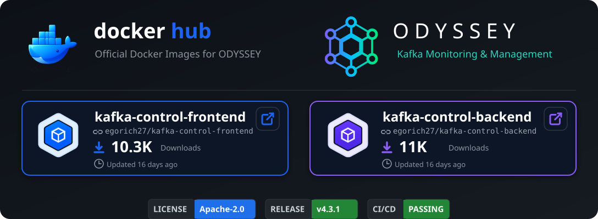

<!-- readme-ru:start -->

# ODYSSEY 

**Русский** | [English](README_ENG.md)

## Docker Hub Statistics

**Odyssey** — современный легковесный веб-интерфейс **Kafka Monitoring & Management** для визуального администрирования Apache Kafka. 
Построен на Go и React с нуля: от консольных утилит до production-готового микросервиса с автоматизированным CI/CD, контейнеризацией, уведомлениями о релизах и возможностью оркестрации в Kubernetes.

> Раньше проект назывался Kafka System Control (KSC).
> Новое имя — Odyssey — отражает суть инструмента: быть надёжным штурвалом и картой для инженера в бушующем море данных Apache Kafka.

### 📌 В чем фишка Odyssey?

Когда вы смотрите на альтернативы вроде *UI for Apache Kafka*, *AKHQ* или *Conductor*, вы сталкиваетесь с необходимостью развертывания тяжелых Enterprise-платформ или прожорливых JVM-сред. 

**Главное отличие Odyssey — работа абсолютно «из коробки».** 

Инструмент написан на Go и React, благодаря чему он невероятно легковесен, быстр и не требует Java runtime. Достаточно запустить два готовых Docker-образа — и у вас в руках полноценная, отзывчивая консоль для всестороннего анализа, оперативного мониторинга и точечного управления вашими кластерами Kafka.

## 🌊 Почему Odyssey?

**Сильный бренд вместо «безликости»**

Прежнее техническое название отлично описывало суть, но звучало перегруженно. Odyssey — короткое, запоминающееся имя, которое легко пишется в консоли, быстро гуглится и формирует уникальный ИТ-бренд инфраструктурного ПО.

**Метафора для SRE и DevOps**

В греческой мифологии Одиссей — великий штурман и капитан, прошедший сквозь рифы, шторма и ловушки. Apache Kafka — это огромное и непредсказуемое море данных, где каждый день штормит от лагов консьюмеров, падения брокеров и просроченных SSL-сертификатов. Odyssey выступает в роли надёжного и точного штурвала для инженера.

**Экспертиза из Финтеха**

Инструмент спроектирован с учетом жестких требований к безопасности, производительности и удобству, основанных на многолетнем опыте эксплуатации высоконагруженных платформ в крупнейших банковских экосистемах.

**Чёткое позиционирование**

Позиционирование Odyssey как **Kafka Monitoring & Management** сразу заявляет, что это визуальный, легкий, но при этом мощный инструмент всестороннего контроля, анализа и управления очередями сообщений.

## Возможности Odyssey Core

- Интерфейс RU/EN, светлая и тёмная темы, переключение Kafka-профилей и ссылка на документацию в Sidebar.
- Обзор, брокеры, топики, группы потребителей, поиск сообщений и Kafka ACL.
- PLAINTEXT, mTLS и SASL PLAIN или SCRAM поверх TLS. GSSAPI временно отключён.
- Локальный владелец, серверные сессии, зашифрованные профили и серверная политика адресов.
- Мастер HTTPS в Docker с локальным CA, собственным PEM или Let's Encrypt для подходящего публичного домена.

[Документация RU](https://egorich88.github.io/odyssey-kafka/) · [English documentation](https://egorich88.github.io/odyssey-kafka/en/)

## 🏗️ Архитектура

| Компонент | Технологии |
|---|---|
| **Frontend** | React, Vite, TypeScript, CSS |
| **Backend** | Go, Sarama (Kafka Admin API), net/http |
| **Инфраструктура** | Docker, Docker Compose, GitHub Actions, Docker Hub, Terraform, Yandex Cloud |
| **Оркестрация** | Kubernetes (Yandex Managed Kubernetes) |
| **Уведомления** | Telegram Bot API, MAX Bot API |

## Быстрый старт

Используйте исходники выбранного тега и пройдите [мастер HTTPS](docs/https-first-run.md). Стандартные адреса Docker-установки: мастер на `http://localhost:8787/setup/`, интерфейс на `https://localhost:8443`. Владелец создаётся интерактивно на Docker-хосте. Разрешите bootstrap и advertised endpoints Kafka на сервере перед подключением.

Для обновления сохраните приватные тома и отдельный ключ. Если профили ещё находятся в браузере, сначала выполните [миграцию на прежнем origin](docs/security-owner-migration.md).

## 🔁 CI/CD (GitHub Actions)

Workflow разделен на три независимых автоматизированных шага:

- **verify** — триггерится на любой push в ветку `main`. Проверяет корректность сборки backend и frontend компонентов без публикации артефактов.
- **release** — запускается строго при создании тега версии `v*`. Осуществляет сборку и пуш продакшн-образов в Docker Hub, формирует GitHub Release.
- 🧪 **deploy-to-kubernetes** — ручной запуск сценария развертывания через `workflow_dispatch` с флагом `deploy=true`.

Официальные образы:
- `egorich27/kafka-control-backend`
- `egorich27/kafka-control-frontend`

## 🔔 Уведомления о релизах

Автоматические уведомление о выходе нового релиза в канал: **«Odyssey - Kafka Monitoring & Management»**:

 **Telegram** — сообщение с описанием изменений и скриншотом релиза.

 **MAX** — сообщение с описанием изменений и вложенным изображением.

## 📦 Релизы
Вся история версий доступна на странице
Releases.

Каждый релиз включает:

- Docker-образы, готовые к использованию.

- Подробный changelog.

- Архив исходного кода.

## 🤝 Автор

🧑‍💻**Egorich88**

Проект создан как демонстрация современных DevOps-подходов:
от консольных скриптов до production-готовых микросервисов с полным CI/CD.

«**Movement – life!**»

## 📄 Лицензия

Этот проект распространяется под лицензией **Apache License 2.0**. Подробности в файле [LICENSE](LICENSE).

## ⚠️ Товарный знак

Название «Kafka» и логотип Kafka являются зарегистрированными товарными знаками The Apache Software Foundation (ASF). Odyssey — это независимый инструмент с открытым исходным кодом, предназначенный для управления кластерами Apache Kafka. Odyssey не является частью Apache Kafka, не поддерживается и не спонсируется ASF. Все упоминания «Kafka» и «Кафка» используются исключительно в техническом смысле для обозначения совместимой технологии.

## Powered by

<!-- readme-ru:end -->
