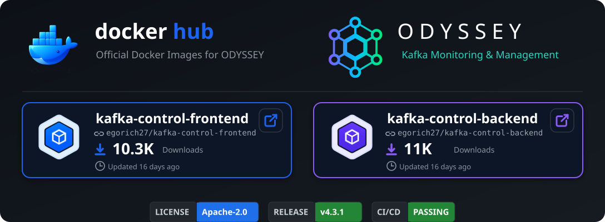

<!-- readme-en:start -->

# Odyssey

[Русский](README.md) | **English**

## Docker Hub Statistics

**Odyssey** is a modern, lightweight web interface **Kafka Monitoring & Management** for visual administration of Apache Kafka.
Built with Go and React from scratch: from console utilities to a production-ready microservice with automated CI/CD, containerization, release notifications and Kubernetes orchestration.

> The project was previously called Kafka System Control (KSC).
> The new name — Odyssey — reflects the essence of the tool: to be a reliable helm and map for the engineer in the stormy sea of Apache Kafka data.

### 📌 What Makes Odyssey Special?

When you look at alternatives like *UI for Apache Kafka*, *AKHQ*, or *Conductor*, you run into the need to deploy heavy enterprise platforms or resource-hungry JVM environments.

**Odyssey's key difference is that it works absolutely "out of the box."**

The tool is written in Go and React, which makes it incredibly lightweight, fast, and free of any Java runtime requirement. Just spin up two ready-made Docker images — and you have a fully-featured, responsive console for comprehensive analysis, real-time monitoring, and precise management of your Kafka clusters.

## 🌊 Why Odyssey

**A strong brand instead of a faceless name**

The previous technical name described the essence well, but sounded overloaded. Odyssey is a short, memorable name that is easy to type in the console, quick to search for and forms a unique IT brand of infrastructure software.

**A metaphor for SRE and DevOps**

In Greek mythology, Odysseus was a great navigator and captain who passed through reefs, storms and traps. Apache Kafka is a vast and unpredictable sea of data, where every day storms with consumer lags, broker failures and expired SSL certificates. Odyssey acts as a reliable and precise helm for the engineer.

**Fintech expertise**

The tool is designed with strict requirements for security, performance and usability, based on years of experience operating high-load platforms in major banking ecosystems.

**Clear positioning**

Positioning Odyssey as **Kafka Monitoring & Management** immediately states that it is a visual, lightweight yet powerful tool for comprehensive control, analysis and management of message queues.

## Odyssey Core features

- Russian and English UI, light and dark themes, Kafka profile switching, and a permanent Sidebar documentation link.
- Overview, Brokers, Topics, Consumer Groups, message search, and Kafka ACLs.
- PLAINTEXT, mTLS, and SASL PLAIN or SCRAM over TLS. GSSAPI is temporarily disabled.
- A local owner account, server sessions, encrypted profiles, and a server-side Kafka address policy.
- A Docker HTTPS wizard with a local CA, custom PEM, or Let's Encrypt for eligible public domains.

[English documentation](https://egorich88.github.io/odyssey-kafka/en/) · [Документация RU](https://egorich88.github.io/odyssey-kafka/)

## 🏗️ Architecture

| Component | Technologies |
|---|---|
| **Frontend** | React, Vite, TypeScript, CSS |
| **Backend** | Go, Sarama (Kafka Admin API), net/http |
| **Infrastructure** | Docker, Docker Compose, GitHub Actions, Docker Hub, Terraform, Yandex Cloud |
| **Orchestration** | Kubernetes (Yandex Managed Kubernetes) |
| **Notifications** | Telegram Bot API, MAX Bot API |

## Quick start

Use the source tree for the target tag and follow the [Docker HTTPS setup guide](docs/en/getting-started.md). The default setup wizard is at `http://localhost:8787/setup/`; the application opens at `https://localhost:8443`. Create the owner interactively on the Docker host and allow the bootstrap and advertised Kafka endpoints before connecting.

Preserve private volumes and the separate encryption key during upgrades. If older profiles still live in the browser, migrate them on the original origin first.

## 🔁 CI/CD (GitHub Actions)

The workflow is split into three independent automated stages:

- **verify** — triggered on any push to the `main` branch. Validates the build of backend and frontend components without publishing artifacts.
- **release** — runs strictly when a version tag `v*` is created. Builds and pushes production images to Docker Hub, generates GitHub Release.
- 🧪 **deploy-to-kubernetes** — manual deployment scenario via `workflow_dispatch` with the `deploy=true` flag.

Official images:
- `egorich27/kafka-control-backend`
- `egorich27/kafka-control-frontend`

## 🔔 Release Notifications

When a new `v*` tag is pushed, a notification is automatically sent to two channels of **"Odyssey - Kafka Monitoring & Management"**:

 **Telegram** — message with changelog and release screenshot.

 **MAX** — message with changelog and attached image.

Notifications are generated from commits between the previous and the current tag.
Screenshots are stored in `docs/screenshots/` and matched by name equal to the
tag (e.g. `v4.2.24.png`).

## 📦 Releases

Full version history is available on the
[Releases](https://github.com/Egorich88/odyssey-kafka/releases) page.

Each release includes:

- Ready-to-use Docker images.
- Detailed changelog, automatically generated from commits.
- Source code archive.

## 🤝 Author

🧑‍💻 **Egorich88**

The project was created as a demonstration of modern DevOps practices:
from console scripts to production-ready microservices with full CI/CD.

> "Movement – life!"

## 📄 License

This project is licensed under the **Apache License 2.0**. See [LICENSE](LICENSE) for details.

## ⚠️ Trademark

The name "Kafka" and the Kafka logo are registered trademarks of The Apache Software Foundation (ASF). Odyssey is an independent open-source tool designed to manage Apache Kafka clusters. Odyssey is not part of Apache Kafka, not endorsed or sponsored by ASF. All references to "Kafka" are used purely in a technical sense to denote compatible technology.

## Powered by

<!-- readme-en:end -->
